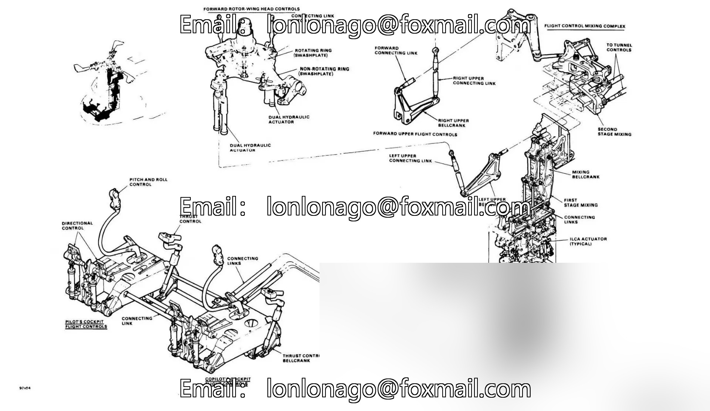
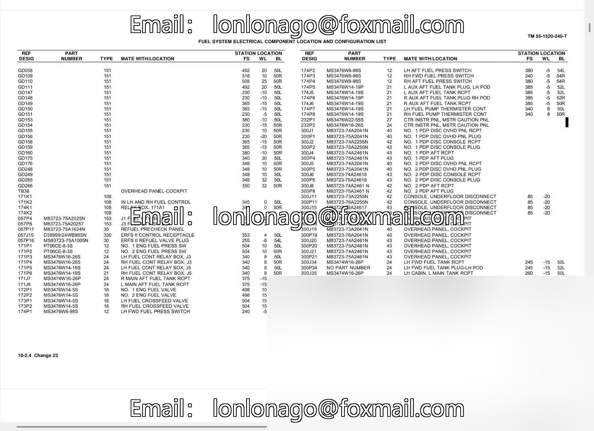
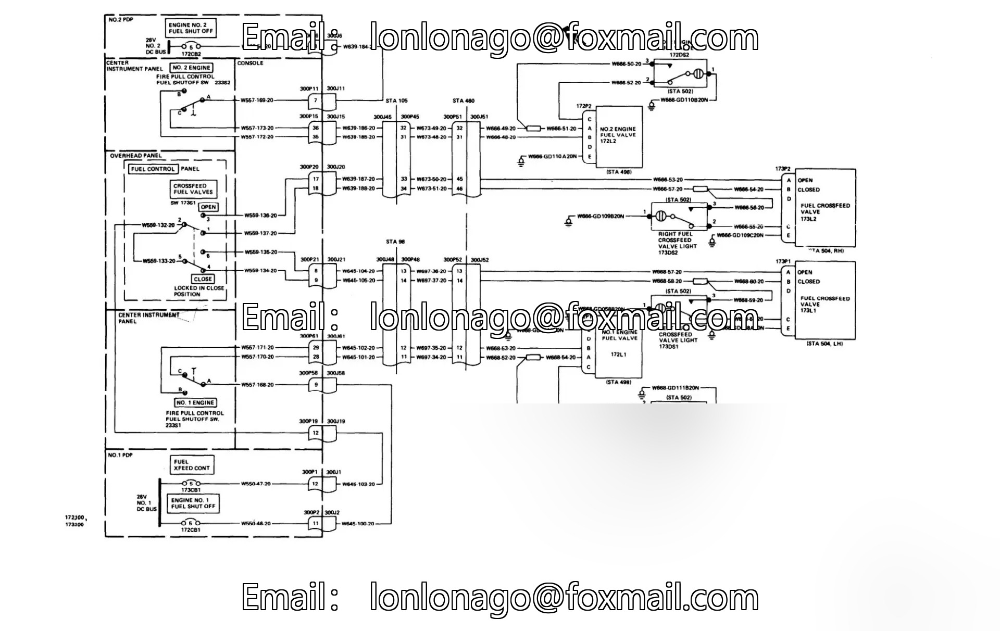
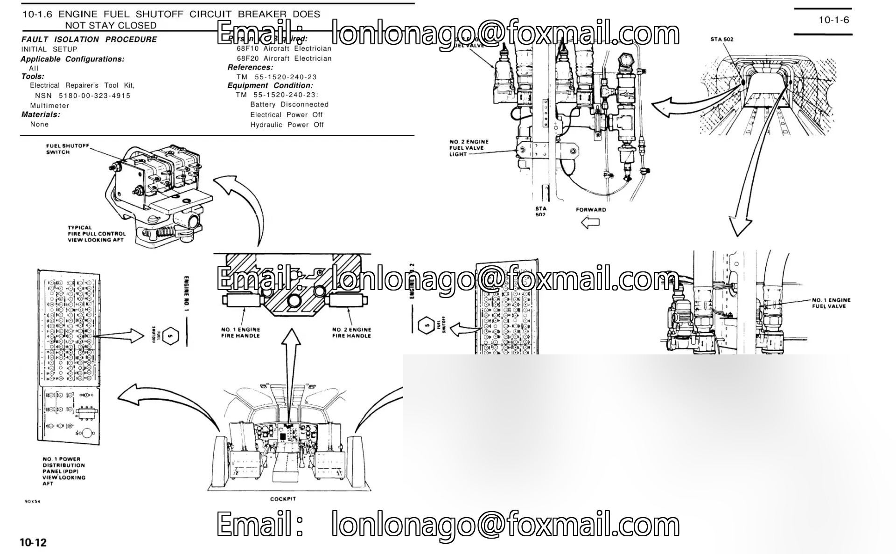
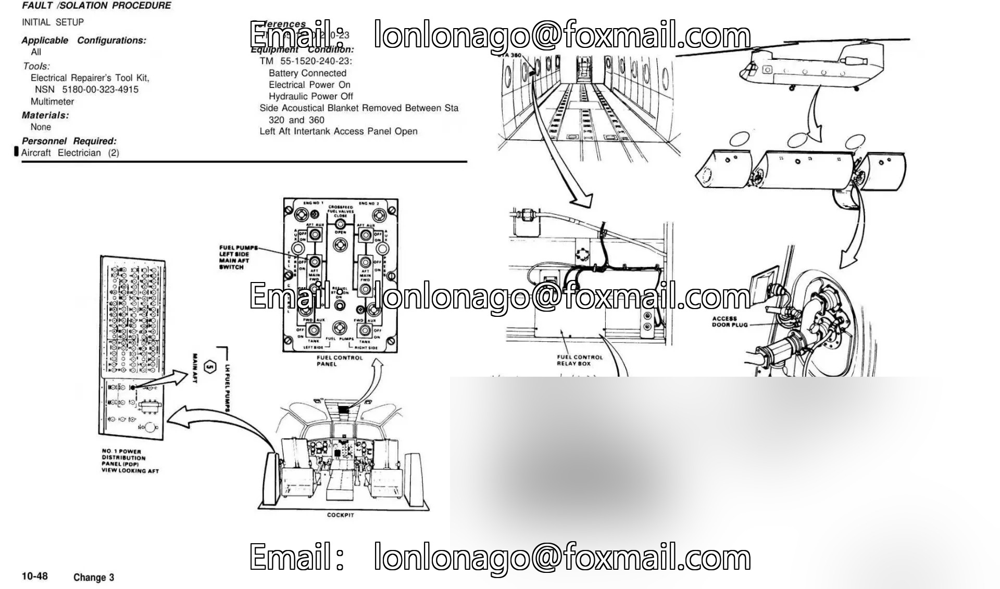

# Official technical manual of latest revision for CH-47D helicopter unit and mid-level maintenance troubleshooting

## Body

The latest revised edition of the official technical manual for maintenance and troubleshooting of the CH-47D helicopter unit and mid-level maintenance.

The manual covers CH-47D helicopters, intermediate maintenance troubleshooting and related materials; the images show control, actuation and component details.

<!-- AI_ENRICHED -->

## Images

## Payment

Here is a pay link on Stripe ( https://buy.stripe.com/3cs8yP7sY87d0vu9AB ). Please contact me lonlonago@foxmail.com after funding $89, and I will send you a complete data files , thank you!

